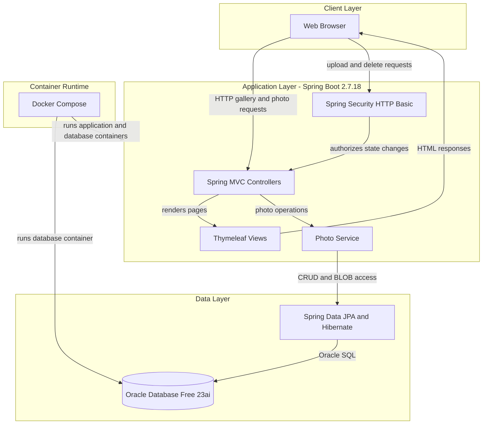
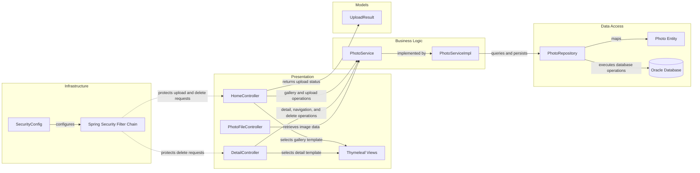

# Architecture Diagram

Photo Album is a server-rendered Spring Boot application for browsing, uploading, serving, and deleting photos. It persists photo data and metadata in Oracle Database and can be run with the database using Docker Compose.

## Application Architecture

### Technology Stack Summary

| Layer | Technology | Version | Purpose |
|---|---|---|---|
| Application runtime | Java | 8 | Runs the server-side application |
| Application framework | Spring Boot | 2.7.18 | Application configuration and runtime |
| Presentation | Spring MVC and Thymeleaf | Spring Boot managed | Handles HTTP requests and renders server-side HTML |
| Security | Spring Security | Spring Boot managed | HTTP Basic authentication for photo upload and deletion |
| Data access | Spring Data JPA and Hibernate | Spring Boot managed | Persists photo entities and performs database queries |
| Database driver | Oracle JDBC ojdbc8 | Maven-managed | Connects the application to Oracle Database |
| Database | Oracle Database Free | 23ai container image | Stores photo metadata and image BLOBs |
| Container orchestration | Docker Compose | Not specified | Runs the application and Oracle database containers |

### Data Storage & External Services

Oracle Database is the application's only identified data store. Spring Data JPA and Hibernate access Oracle through the Oracle JDBC driver; photo metadata and image bytes are stored together, with image bytes held as BLOB data. Docker Compose provisions the database alongside the application. No cache, message broker, or external API integration was identified.

### Key Architectural Decisions

- Uses Spring MVC with Thymeleaf for server-rendered gallery and detail pages, with a JSON response for uploads.
- Separates photo operations behind a service interface and Spring Data JPA repository.
- Stores uploaded images in Oracle rather than on the application filesystem; Spring Security requires HTTP Basic authentication for uploads and deletion.

## Component Relationships

### Component Inventory

| Component | Layer | Type | Responsibility |
|---|---|---|---|
| HomeController | Presentation | Spring MVC Controller | Displays the gallery and handles multi-file upload requests |
| DetailController | Presentation | Spring MVC Controller | Displays a photo, provides previous and next navigation, and handles deletion |
| PhotoFileController | Presentation | Spring MVC Controller | Serves image bytes from the database with the stored media type |
| Thymeleaf Views | Presentation | Server-rendered templates | Render the gallery and photo detail pages |
| PhotoService | Business Logic | Service interface | Defines photo retrieval, upload, navigation, and deletion operations |
| PhotoServiceImpl | Business Logic | Spring service | Validates uploaded images and coordinates photo persistence and retrieval |
| PhotoRepository | Data Access | Spring Data JPA repository | Performs entity CRUD and photo-specific Oracle queries |
| Photo | Data Access | JPA entity | Maps photo metadata and image BLOB data to the database |
| SecurityConfig | Infrastructure | Spring configuration | Defines password encoding, in-memory admin credentials, and HTTP authorization |
| Spring Security Filter Chain | Infrastructure | Security filters | Enforces HTTP Basic authentication for upload and delete endpoints |
| UploadResult | Models | Response model | Carries upload success, photo identifier, filename, and error information |
