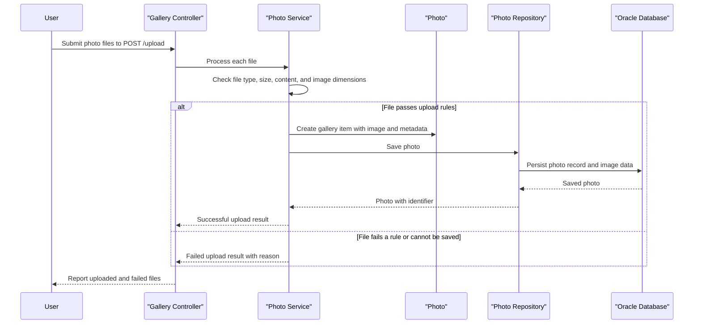

# Core Business Workflows

Photo Album lets users upload, browse, inspect, navigate, and remove photos from a shared gallery. Each accepted photo and its image data are kept together as a persistent gallery item.

## Domain Entities

| Entity | Service / Bounded Context | Description | Key Relationships |
|---|---|---|---|
| Photo | Photo Album / Gallery Management | A user-contributed image managed as a gallery item, with information used to display and navigate the collection. | Each photo is independently addressable in the gallery and is the unit of upload, viewing, navigation, and deletion. |
| UploadResult | Photo Album / Gallery Management | The outcome of processing an individual uploaded file, including its success or failure and any associated photo identifier. | Produced for each file submitted to the upload workflow; a successful result identifies the persisted Photo. |

## Service-to-Domain Mapping

The application is a single deployable Spring MVC application, not a set of independently deployable business services. Its presentation, business operations, and persistence components share the Photo Album bounded context.

| Service | Domain Context | Owned Entities | External Dependencies |
|---|---|---|---|
| HomeController and DetailController | Gallery presentation and workflows | None; coordinates gallery operations | PhotoService |
| PhotoFileController | Photo delivery | None; retrieves image data for display | PhotoService |
| PhotoServiceImpl | Gallery management | Photo lifecycle and UploadResult outcomes | PhotoRepository; Oracle database through JPA |
| PhotoRepository | Gallery persistence | Persists and queries Photo records | Oracle database |

All photo records, including their image data, are owned by this application and stored in Oracle. There are no cross-service APIs, events, or shared cross-context identifiers.

## Primary Workflows

### Workflow 1: Upload Photos

An authenticated user submits one or more files through the upload interface to `POST /upload`. The controller processes each file independently through PhotoService. For each file, the service checks the supported MIME type, configured per-file size limit, non-empty content, and image pixel limit when dimensions can be read. Invalid files receive an individual failure result; accepted data is stored as a Photo in Oracle and returned with its identifier. The controller gathers successful photo summaries and per-file failures, allowing partial success when a batch contains both accepted and rejected files.

### Workflow 2: Browse and View a Photo

The gallery page at `GET /` requests photos ordered newest-first and renders each photo with its metadata. Selecting an item opens `GET /detail/{id}`; the controller retrieves that photo and asks the service for the adjacent older and newer photos by upload time. The image is served separately from `GET /photo/{id}` using the Photo's stored image data. If a photo cannot be found, the detail and image handlers return the user to the gallery or return not found, respectively.

### Workflow 3: Delete a Photo

An authenticated user submits the delete form to `POST /detail/{id}/delete`. PhotoService looks up the photo; if present, it deletes that record (including the database-stored image) and the controller reports success. If no photo exists, the controller reports that it was not found. The user is redirected to the gallery.

## Cross-Service Data Flows

There are no cross-service composition or aggregation flows: all business operations run within one application. The PhotoService coordinates with the PhotoRepository, which reads or writes the Photo and its image data in Oracle. Gallery, detail, and image responses are assembled from this same source of truth; no remote-service fallback path is implemented.

## Business Workflow Sequence

The upload workflow is the primary business process. Each submitted file is handled independently, so a failed validation or save for one file does not prevent the controller from processing the remaining files.

## Business Rules & Decision Logic

- **Supported file types:** Upload accepts MIME types configured as JPEG, PNG, GIF, or WebP.
- **Per-file size and content:** Each file must be non-empty and no larger than the configured 10 MiB limit. The HTTP multipart request also has a configured maximum request size.
- **Image dimensions:** When image dimensions can be read, images exceeding 40 million pixels are rejected. If dimensions cannot be extracted, upload continues without dimension metadata.
- **Batch outcomes:** Each file produces an independent outcome. The response includes successful photo summaries and individual failures; its overall success flag is true when at least one uploaded photo is included.
- **Gallery ordering and navigation:** Gallery entries are ordered newest-first. Detail navigation finds older and newer items using upload timestamps.
- **Photo lifecycle:** A successful upload creates a persistent Photo; deletion removes it from the gallery and database. No additional business lifecycle states are modeled.
- **Authorization:** Gallery and photo reads are public. Upload and delete POST operations require HTTP Basic authentication.
- **Persistence boundary:** PhotoService operations use transaction management for database changes. There are no distributed transactions, event-driven side effects, or compensating workflows.
- **Failure handling:** Missing photos yield not-found behavior for image retrieval and a not-found message for deletion. Upload validation and persistence failures are represented as per-file errors; no external-service fallback applies.
