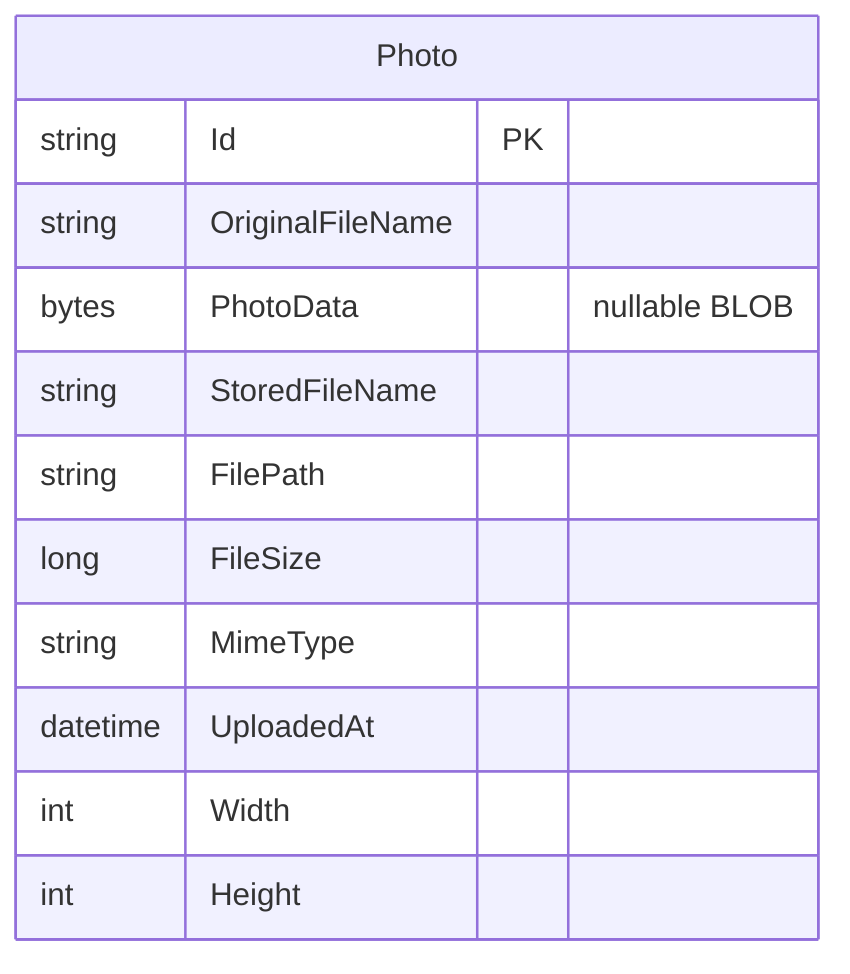

# Data Architecture & Persistence Layer

The application has one JPA entity, `Photo`, persisted in a relational database through Hibernate. Oracle is configured for the normal and Docker profiles, while tests use an in-memory H2 database.

## Database Configuration

| Service/Module | DB Type | Profile | Driver | Connection | Migration Tool |
|---|---|---|---|---|---|
| Photo Album | Oracle | Default (no explicit profile) | Oracle JDBC (`ojdbc8`) | JDBC URL defaults to `jdbc:oracle:thin:@oracle-db:1521/FREEPDB1`; URL and credentials can be supplied through environment variables. Spring Boot's default HikariCP pool is used; no pool sizing is explicitly configured. | None. Hibernate creates the schema at startup; no versioned migrations or seed scripts were found. |
| Photo Album | Oracle | `docker` | Oracle JDBC (`ojdbc8`) | Same Oracle service URL by default; Docker supplies the URL and credentials through environment variables. Spring Boot's default HikariCP pool is used; no pool sizing is explicitly configured. | None. Hibernate creates the schema at startup. |
| Photo Album | H2 (in-memory) | `test` | H2 (`org.h2.Driver`, test-scoped dependency) | `jdbc:h2:mem:testdb` | None. Hibernate creates the schema for tests and drops it when the test context closes. |

The database and schema-generation settings are defined in the application property files; see `configuration-inventory.md` for the property-level inventory. No database seed data was found.

## Data Ownership per Service

| Service | Tables Owned | ORM Framework | Caching | Notes |
|---|---|---|---|---|
| Photo Album | `PHOTOS` (`Photo`) | Spring Data JPA / Hibernate | None found | Single application-owned table; photo bytes are stored in a BLOB. |

## Entity Model

`Photo` maps to the `photos` table and owns its upload metadata and image bytes. The table has an index on `uploaded_at`. Its identifier is a UUID string generated in Java. There are no entity relationships or join tables. `UploadResult` is a service response model, not a persisted entity.

Source: `src/main/java/com/photoalbum/model/Photo.java`.

The service implementation applies transaction boundaries at class level, with read-only transactions for retrieval methods: `src/main/java/com/photoalbum/service/impl/PhotoServiceImpl.java`. The model's `photo_data` mapping is nullable even though the normal upload path supplies the photo bytes.

## Key Repository Methods

| Service | Repository | Notable Methods | Purpose |
|---|---|---|---|
| Photo Album | `PhotoRepository` — `src/main/java/com/photoalbum/repository/PhotoRepository.java`, entity `Photo` | `findAllOrderByUploadedAtDesc(): List<Photo>` | Native query returns photos newest first. |
| Photo Album | `PhotoRepository` | `findPhotosUploadedBefore(LocalDateTime): List<Photo>` | Native Oracle query selects up to ten older photos for navigation. |
| Photo Album | `PhotoRepository` | `findPhotosUploadedAfter(LocalDateTime): List<Photo>` | Native Oracle query selects newer photos for navigation. |
| Photo Album | `PhotoRepository` | `findPhotosByUploadMonth(String, String): List<Photo>` | Native Oracle query filters by year and month. |
| Photo Album | `PhotoRepository` | `findPhotosWithPagination(int, int): List<Photo>` | Native Oracle `ROWNUM` query returns a row range. |
| Photo Album | `PhotoRepository` | `findPhotosWithStatistics(): List<Object[]>` | Native Oracle analytical query returns photos with ranking and running-total columns. |

The repository extends `JpaRepository<Photo, String>`, inheriting standard CRUD operations. The custom queries are native SQL, several of which use Oracle-specific features; no cross-service aggregation methods were found.

## Caching Strategy

No application cache provider, cache annotations, cache manager, JCache binding, or Hibernate second-level cache configuration was found. Data access uses repository/database queries without an identified application-level caching pattern or TTL/eviction policy.

## Data Ownership Boundaries

The project has one application and one logical data owner. The default and Docker profiles connect to Oracle; the test profile uses an isolated in-memory H2 database. The application reads and writes its own `PHOTOS` table through Spring Data JPA, with transaction management in the service layer. There are no other services, cross-service database access patterns, or CQRS/read-model boundaries identified.

### Data Classification & Sensitivity

| Entity | Sensitive Fields | Classification (PII/PHI/PCI/None) | Controls in Place |
|---|---|---|---|
| `Photo` | `original_file_name`, `photo_data` (image content may identify people) | Potential PII | No field-level encryption, data masking, or field-level access controls were found in the application configuration. Encryption at rest is not established by the project configuration. No PHI or PCI fields were identified. |
