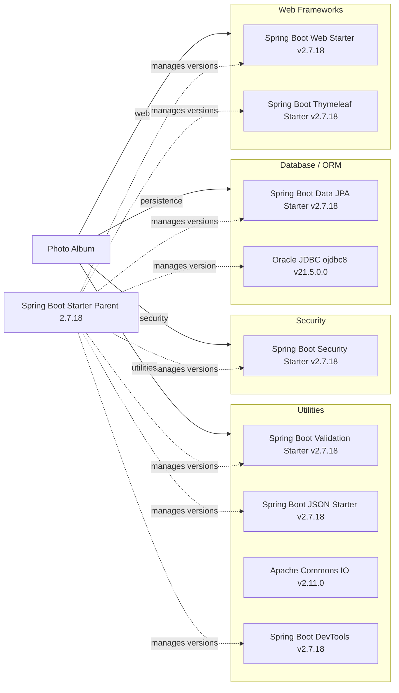

# Dependency Map

Photo Album declares 11 direct dependencies: 9 non-test dependencies and 2 test-scoped dependencies. Versions not explicitly set in `pom.xml` are managed by Spring Boot Starter Parent 2.7.18.

## Dependencies

### Dependency Summary

| Category | Count | Key Libraries | Notes |
|---|---:|---|---|
| Web Frameworks | 2 | Spring Boot Web, Thymeleaf | Spring MVC application with server-rendered templates |
| Database / ORM | 2 | Spring Data JPA, Oracle JDBC | ORM and Oracle runtime driver |
| Security | 1 | Spring Boot Security | Spring-managed security stack |
| Utilities | 4 | Validation, JSON, Commons IO, DevTools | DevTools is optional; Commons IO is explicitly pinned |

### Version & Compatibility Risks

Spring Boot 2.7.18 is the final 2.x release and is outside the community support window; migration to a supported Spring Boot line will also require reviewing Java 8 compatibility, since newer Spring Boot generations require a newer Java baseline. The Oracle JDBC driver is selected through the Boot parent dependency management, so its effective version should be re-evaluated as part of that upgrade.

### Notable Observations

- The parent POM manages versions for all direct dependencies except Commons IO, which is explicitly set to 2.11.0.
- The Spring Boot Web Starter already provides JSON support; the separately declared JSON starter may duplicate that functionality.
- The Oracle JDBC driver is runtime-scoped, while H2 is confined to tests.

## Test Dependencies

| Framework | Version | Notes |
|---|---|---|
| Spring Boot Test Starter | 2.7.18 | Test-scope starter; its underlying test libraries are transitive and not individually declared in `pom.xml` |
| H2 Database | 2.1.214 | Test-scope in-memory database; version managed by Spring Boot 2.7.18 |

Total test-scope dependencies: 2

The project has a Spring Boot test starter and an in-memory database for tests. The individual versions of transitive test libraries are not pinned in the available build file.
